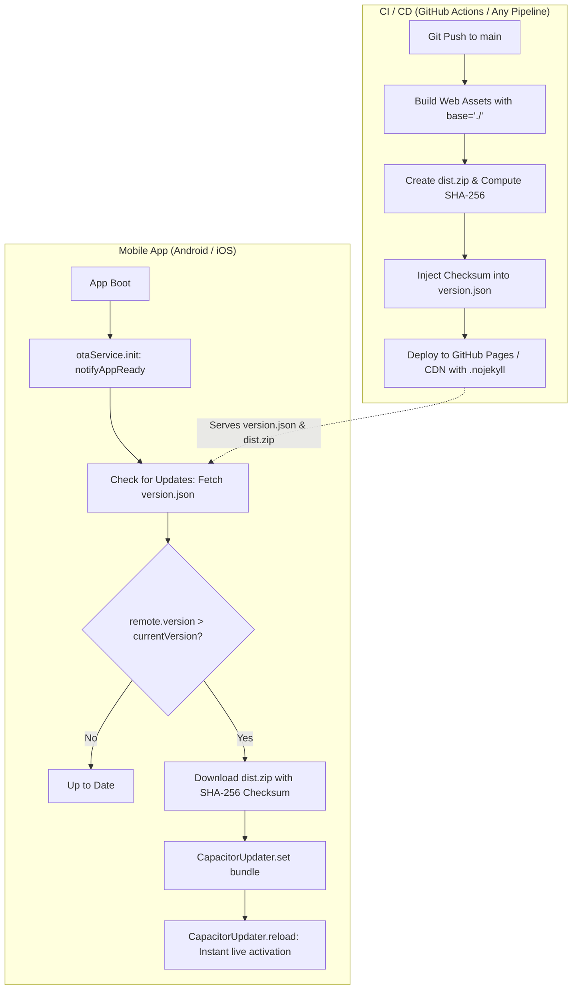

# Universal Capacitor Over-The-Air (OTA) Live Updates: The Definitive Blueprint

A generic, production-ready guide for implementing Over-The-Air (OTA) live updates in any Capacitor application (React, Vue, Svelte, or Vanilla Vite) using `@capgo/capacitor-updater` and GitHub Pages / any static CDN hosting.

Use this document as an exact blueprint for future projects to implement seamless live updates without trial and error.

---

## 1. Architecture Overview



### What OTA Can and Cannot Update
- **CAN update**: HTML, CSS, JavaScript, Web Assets, Images, Fonts, Translations, Frontend Business Logic.
- **CANNOT update**: `AndroidManifest.xml`, `Info.plist`, native permissions, native Java/Kotlin/Swift plugins, or App Launcher Icons. Native changes always require building and distributing a new APK/AAB or IPA.

---

## 2. The 5 Golden Traps (Save Days of Debugging)

### Trap 1: The `"1.0"` Native Shell Version Leak
- **Symptom**: You publish version `0.2.0` or `0.6.5`. Android checks for updates and says: *"App is completely up to date (v1.0)"*. It refuses to update!
- **Root Cause**: On initial install, `@capgo/capacitor-updater` reads the native Android `versionName` (often `"1.0"` in `build.gradle`) as the active bundle version. When comparing `0.2.0` against `1.0`, semantic versioning evaluates `0.2.0 < 1.0` as `false`.
- **Solution**: Always normalize the bundle version with `getActiveSiteVersion()`. If the reported bundle is `"1.0"`, `"1.0.0"`, `"builtin"`, or `"default"`, ignore it and fall back to the compiled web bundle version (`WEB_BUNDLE_VERSION`).

### Trap 2: The Missing Checksum / "Failed to download" Crash
- **Symptom**: The app finds the update, but tapping "Update" immediately throws: `Failed to download from: .../dist.zip`.
- **Root Cause**: `@capgo/capacitor-updater` v7+ has strict native checks that throw `IOException("Checksum required")` if a SHA-256 hash is not passed in the download options.
- **Solution**:
  1. Have CI/CD calculate the SHA-256 of `dist.zip` and write `"checksum"` into `version.json`.
  2. Pass `checksum: manifest.checksum` in `CapacitorUpdater.download()`.
  3. Include a client-side Web Crypto fallback (`crypto.subtle.digest('SHA-256')`) in JS if the manifest ever lacks a checksum.
  4. Run a `postinstall` script (`patch-capacitor-updater.js`) to prevent native Android Java from hard-crashing if a checksum is absent.

### Trap 3: The Blank White Screen on Reload (Base Path Mismatch)
- **Symptom**: The update downloads and applies, but upon reload the screen turns blank white and stays white across app restarts.
- **Root Cause**: If Vite builds with an absolute base path (e.g., `base: '/my-app/'`), `index.html` has `<script src="/my-app/assets/index.js">`. But on Android/iOS, Capacitor serves locally from `https://localhost/`. The WebView requests `https://localhost/my-app/assets/...` $\rightarrow$ **404 Not Found** $\rightarrow$ React/Vue never mounts $\rightarrow$ white screen.
- **Solution**: Always configure Vite with relative paths: `base: './'`. In `index.html`, script tags will be `<script src="./assets/index.js">`, which resolves correctly on both web servers and `https://localhost/`.

### Trap 4: GitHub Pages Hanging in `updating_pages` Loop
- **Symptom**: GitHub Actions deploy job runs for 10+ minutes looping on: `Current status: updating_pages`.
- **Root Cause**: Without an explicit `.nojekyll` file, GitHub Pages spins up Jekyll on every push. Jekyll attempts to parse ruby templates across every font, bundle, and binary `dist.zip`. Furthermore, `concurrency: cancel-in-progress: false` causes previous runs to hold the environment lock.
- **Solution**:
  1. Add `public/.nojekyll` (copied to `dist/.nojekyll` on build).
  2. In the workflow, set `concurrency: { group: 'pages', cancel-in-progress: true }`.
  3. Add `timeout-minutes: 5` to the deploy job.

### Trap 5: Automatic Recovery from Broken Bundles
- **Symptom**: If an invalid bundle is ever downloaded, the user is permanently locked out until they clear phone data.
- **Solution**: In `capacitor.config.ts`, set `resetWhenUpdate: true` and `autoDeleteFailed: true`. If a bundle crashes or fails to call `notifyAppReady()`, the plugin deletes the bad bundle and boots the clean built-in bundle.

---

## 3. Project Configuration

### Step 1: Install Dependencies
```bash
npm install @capgo/capacitor-updater
npx cap sync
```

### Step 2: `capacitor.config.ts`
```typescript
import type { CapacitorConfig } from '@capacitor/cli';

const config: CapacitorConfig = {
  appId: 'com.yourorg.app',
  appName: 'YourApp',
  webDir: 'dist',
  server: {
    androidScheme: 'https',
  },
  plugins: {
    CapacitorUpdater: {
      autoUpdate: false,      // Managed by dedicated otaService
      resetWhenUpdate: true,  // Clear old bundles on new native APK/IPA install
      autoDeleteFailed: true, // Roll back automatically if a bundle fails to boot
    },
  },
};

export default config;
```

### Step 3: `vite.config.ts`
Enforce relative paths (`./`) so assets resolve identically on the web and inside Capacitor's local WebView:
```typescript
import { defineConfig } from 'vite';
import react from '@vitejs/plugin-react';

export default defineConfig({
  base: process.env.VITE_BASE_PATH || './', // MUST be './' for Capacitor OTA!
  plugins: [react()],
});
```

### Step 4: Add `.nojekyll`
Create an empty file at `public/.nojekyll`:
```bash
# In your terminal
touch public/.nojekyll
```

### Step 5: Version Manifest (`public/version.json`)
```json
{
  "version": "1.0.0",
  "buildNumber": 1,
  "downloadUrl": "https://your-domain.com/dist.zip",
  "checksum": "",
  "releaseNotes": "Initial release",
  "releasedAt": "2026-10-15T00:00:00Z"
}
```

---

## 4. Implementation Code

### Step 6: Pure Semver & Manifest Engine (`src/engine/otaUpdate.ts`)
```typescript
export const APP_SHELL_VERSION = '1.0.0'; // Native wrapper version (e.g. build.gradle / Info.plist)
export const APP_SHELL_DISPLAY = 'v1.0.0';
export const WEB_BUNDLE_VERSION = '1.0.0'; // Active compiled web bundle version
export const DEFAULT_UPDATE_MANIFEST_URL = 'https://your-domain.com/version.json';

export interface UpdateManifest {
  version: string;
  buildNumber?: number;
  downloadUrl: string;
  checksum?: string;
  releaseNotes?: string;
  releasedAt?: string;
}

/**
 * Normalizes bundle versions. Strips native APK/IPA placeholder versions ('1.0', 'builtin', 'default').
 */
export function getActiveSiteVersion(bundleVersion?: string | null): string {
  if (!bundleVersion) return WEB_BUNDLE_VERSION;
  const v = bundleVersion.trim().toLowerCase();
  if (
    v === 'builtin' ||
    v === 'default' ||
    v === '1.0' ||
    v === '1.0.0' ||
    v === APP_SHELL_VERSION.toLowerCase() ||
    v === `v${APP_SHELL_VERSION.toLowerCase()}`
  ) {
    return WEB_BUNDLE_VERSION;
  }
  if (isNewerVersion(bundleVersion, WEB_BUNDLE_VERSION)) {
    return bundleVersion.replace(/^[vV]/, '');
  }
  return WEB_BUNDLE_VERSION;
}

/**
 * Robust SemVer comparison: returns true if remote > current.
 */
export function isNewerVersion(remoteVersion: string, currentVersion: string): boolean {
  if (!remoteVersion || !currentVersion) return false;
  const clean = (v: string) => v.trim().replace(/^[vV]/, '').split(/[-+]/)[0];
  const rParts = clean(remoteVersion).split('.').map((p) => parseInt(p, 10) || 0);
  const cParts = clean(currentVersion).split('.').map((p) => parseInt(p, 10) || 0);
  const maxLen = Math.max(rParts.length, cParts.length, 3);
  for (let i = 0; i < maxLen; i++) {
    const r = rParts[i] ?? 0;
    const c = cParts[i] ?? 0;
    if (r > c) return true;
    if (r < c) return false;
  }
  return false;
}

export function parseUpdateManifest(data: unknown): UpdateManifest | null {
  if (!data || typeof data !== 'object') return null;
  const obj = data as Record<string, unknown>;
  if (typeof obj.version !== 'string' || typeof obj.downloadUrl !== 'string') return null;
  return {
    version: obj.version.trim(),
    buildNumber: typeof obj.buildNumber === 'number' ? obj.buildNumber : undefined,
    downloadUrl: obj.downloadUrl.trim(),
    checksum: typeof obj.checksum === 'string' ? obj.checksum.trim() : undefined,
    releaseNotes: typeof obj.releaseNotes === 'string' ? obj.releaseNotes : undefined,
    releasedAt: typeof obj.releasedAt === 'string' ? obj.releasedAt : undefined,
  };
}
```

### Step 7: The OTA Service (`src/services/otaService.ts`)
```typescript
import { Capacitor } from '@capacitor/core';
import { CapacitorUpdater } from '@capgo/capacitor-updater';
import {
  DEFAULT_UPDATE_MANIFEST_URL,
  getActiveSiteVersion,
  isNewerVersion,
  parseUpdateManifest,
  WEB_BUNDLE_VERSION,
  UpdateManifest,
} from '@/engine/otaUpdate';

export interface OtaState {
  status: 'idle' | 'checking' | 'available' | 'up_to_date' | 'downloading' | 'ready' | 'error';
  currentVersion: string;
  manifest?: UpdateManifest | null;
  error?: string | null;
  downloadProgress: number;
}

class OtaService {
  private state: OtaState = {
    status: 'idle',
    currentVersion: WEB_BUNDLE_VERSION,
    manifest: null,
    error: null,
    downloadProgress: 0,
  };
  private listeners: Set<(state: OtaState) => void> = new Set();
  private initialized = false;

  public getState(): OtaState {
    return { ...this.state };
  }

  public subscribe(listener: (state: OtaState) => void) {
    this.listeners.add(listener);
    listener(this.getState());
    return () => this.listeners.delete(listener);
  }

  private setState(partial: Partial<OtaState>) {
    this.state = { ...this.state, ...partial };
    for (const l of this.listeners) l(this.getState());
  }

  public async init(): Promise<void> {
    if (this.initialized) return;
    this.initialized = true;

    if (Capacitor.isNativePlatform()) {
      try {
        // 1. Confirm successful boot of current bundle to prevent rollback
        await CapacitorUpdater.notifyAppReady();

        // 2. Read active bundle version
        const currentBundle = await CapacitorUpdater.current();
        const activeSiteVer = getActiveSiteVersion(currentBundle?.bundle?.version);
        this.setState({ currentVersion: activeSiteVer });

        // 3. Listen for download progress
        CapacitorUpdater.addListener('download', (info: any) => {
          if (info && typeof info.percent === 'number') {
            this.setState({ downloadProgress: Math.round(info.percent) });
          }
        });
      } catch (err) {
        console.warn('[OTA] Native init warning:', err);
      }
    }
  }

  public async checkForUpdate(): Promise<OtaState> {
    this.setState({ status: 'checking', error: null });
    try {
      const cacheBust = `?t=${Date.now()}`;
      const res = await fetch(`${DEFAULT_UPDATE_MANIFEST_URL}${cacheBust}`, { cache: 'no-store' });
      if (!res.ok) throw new Error('Update server unreachable');
      const manifest = parseUpdateManifest(await res.json());
      if (!manifest) throw new Error('Invalid manifest received');

      const activeVersion = getActiveSiteVersion(this.state.currentVersion);
      if (isNewerVersion(manifest.version, activeVersion)) {
        this.setState({ status: 'available', manifest, error: null });
      } else {
        this.setState({ status: 'up_to_date', currentVersion: activeVersion, manifest, error: null });
      }
      return this.getState();
    } catch (err: any) {
      this.setState({ status: 'error', error: err?.message || 'Check failed' });
      return this.getState();
    }
  }

  public async downloadAndApply(options: { autoReload?: boolean } = { autoReload: true }): Promise<boolean> {
    const { manifest } = this.state;
    if (!manifest) return false;

    this.setState({ status: 'downloading', downloadProgress: 0, error: null });

    if (Capacitor.isNativePlatform()) {
      try {
        let checksum = manifest.checksum?.trim() || '';

        // Dynamic SHA-256 fallback if manifest lacks checksum
        if (!checksum && typeof crypto !== 'undefined' && crypto.subtle) {
          try {
            const zipRes = await fetch(manifest.downloadUrl, { cache: 'no-store' });
            if (zipRes.ok) {
              const buf = await zipRes.arrayBuffer();
              const hashBuf = await crypto.subtle.digest('SHA-256', buf);
              checksum = Array.from(new Uint8Array(hashBuf))
                .map((b) => b.toString(16).padStart(2, '0'))
                .join('');
            }
          } catch {}
        }

        const bundle = await CapacitorUpdater.download({
          url: manifest.downloadUrl,
          version: manifest.version,
          ...(checksum ? { checksum } : {}),
        });

        await CapacitorUpdater.set(bundle);
        this.setState({ status: 'ready', downloadProgress: 100, currentVersion: manifest.version });

        if (options.autoReload) {
          await CapacitorUpdater.reload();
        }
        return true;
      } catch (err: any) {
        this.setState({ status: 'error', error: err?.message || 'Download failed' });
        return false;
      }
    } else {
      window.location.reload();
      return true;
    }
  }
}

export const otaService = new OtaService();
```

### Step 8: React Hook (`src/hooks/useOtaUpdate.ts`)
```typescript
import { useState, useEffect } from 'react';
import { otaService, OtaState } from '@/services/otaService';

export function useOtaUpdate() {
  const [state, setState] = useState<OtaState>(otaService.getState());

  useEffect(() => {
    const unsubscribe = otaService.subscribe(setState);
    return () => unsubscribe();
  }, []);

  return {
    ...state,
    checkForUpdate: () => otaService.checkForUpdate(),
    downloadAndApply: (options?: { autoReload?: boolean }) => otaService.downloadAndApply(options),
  };
}
```

### Step 9: Native Checksum Patch Script (`scripts/patch-capacitor-updater.js`)
Prevents Android Java from throwing `IOException("Checksum required")` if a checksum is ever omitted:
```javascript
import fs from 'fs';
import path from 'path';
import { fileURLToPath } from 'url';

const __dirname = path.dirname(fileURLToPath(import.meta.url));

const pluginFile = path.resolve(
  __dirname,
  '../node_modules/@capgo/capacitor-updater/android/src/main/java/ee/forgr/capacitor_updater/CapacitorUpdaterPlugin.java'
);
const serviceFile = path.resolve(
  __dirname,
  '../node_modules/@capgo/capacitor-updater/android/src/main/java/ee/forgr/capacitor_updater/DownloadService.java'
);

function patch(file, target, replacement) {
  if (!fs.existsSync(file)) return;
  let code = fs.readFileSync(file, 'utf8');
  if (code.includes(replacement.trim())) return;
  if (code.includes(target.trim())) {
    fs.writeFileSync(file, code.replace(target.trim(), replacement.trim()), 'utf8');
  }
}

patch(
  pluginFile,
  `if (manifest == null && (checksum == null || checksum.isEmpty())) {
            logger.error("No checksum provided");
            this.implementation.sendStats("checksum_required");
            throw new IOException("Checksum required");
        }`,
  `if (manifest == null && (checksum == null || checksum.isEmpty())) {
            logger.warn("No checksum provided, proceeding without checksum verification");
        }`
);

patch(
  serviceFile,
  `if (checksum == null || checksum.isEmpty()) {
            logger.error("No checksum provided");
            sendStatsAsync("checksum_required", version);
            throw new RuntimeException("Checksum required");
        }`,
  `if (checksum == null || checksum.isEmpty()) {
            logger.warn("No checksum provided, proceeding without checksum verification");
        }`
);
```

Add to `package.json`:
```json
"scripts": {
  "postinstall": "node scripts/patch-capacitor-updater.js",
  "build:android": "tsc && vite build --base=./ && node scripts/patch-capacitor-updater.js && npx cap sync android"
}
```

### Step 10: Production CI/CD Workflow (`.github/workflows/deploy.yml`)
```yaml
name: Deploy Web & OTA Bundle

on:
  push:
    branches: [main]
  workflow_dispatch:

permissions:
  contents: read
  pages: write
  id-token: write

concurrency:
  group: 'pages'
  cancel-in-progress: true # Cancels stale runs and releases deployment locks immediately

jobs:
  build-and-deploy:
    runs-on: ubuntu-latest
    timeout-minutes: 5
    environment:
      name: github-pages
      url: ${{ steps.deployment.outputs.page_url }}
    steps:
      - name: Checkout
        uses: actions/checkout@v4

      - name: Setup Node.js
        uses: actions/setup-node@v4
        with:
          node-version: 20
          cache: 'npm'

      - name: Install Dependencies
        run: npm ci

      - name: Build Web Bundle
        run: npm run build
        env:
          VITE_BASE_PATH: './' # Enforce relative paths!

      - name: Package OTA Zip with SHA-256 Checksum
        run: |
          cd dist
          zip -r ../dist.zip . -x "dist.zip"
          mv ../dist.zip ./dist.zip
          touch .nojekyll
          CHECKSUM=$(sha256sum dist.zip | awk '{print $1}')
          echo "$CHECKSUM  dist.zip" > dist.zip.sha256
          node -e "
            const fs = require('fs');
            const v = JSON.parse(fs.readFileSync('version.json', 'utf8'));
            v.checksum = '$CHECKSUM';
            fs.writeFileSync('version.json', JSON.stringify(v, null, 2));
          "
          cd ..

      - name: Upload Pages Artifact
        uses: actions/upload-pages-artifact@v3
        with:
          path: './dist'

      - name: Deploy to GitHub Pages
        id: deployment
        uses: actions/deploy-pages@v4
```

---

## 5. Standard Drop-In UI Component (`AppUpdateCard.tsx`)

A plug-and-play React UI card displaying current version, auto-update toggle, update availability banner, and progress bar:

```tsx
import React, { useState } from 'react';
import { useOtaUpdate } from '@/hooks/useOtaUpdate';
import { Capacitor } from '@capacitor/core';
import { APP_SHELL_DISPLAY, WEB_BUNDLE_VERSION } from '@/engine/otaUpdate';

export const AppUpdateCard: React.FC = () => {
  const { status, currentVersion, manifest, error, downloadProgress, checkForUpdate, downloadAndApply } =
    useOtaUpdate();
  const [isUpdating, setIsUpdating] = useState(false);
  const isNative = Capacitor.isNativePlatform();

  const handleInstall = async () => {
    setIsUpdating(true);
    await downloadAndApply({ autoReload: true });
    setIsUpdating(false);
  };

  return (
    <div style={{ padding: '16px', borderRadius: '12px', border: '1px solid #e2e8f0' }}>
      <div style={{ display: 'flex', justifyContent: 'space-between', alignItems: 'center' }}>
        <div>
          <h4 style={{ margin: 0, fontWeight: 600 }}>App Version &amp; Updates</h4>
          <p style={{ margin: '4px 0 0', fontSize: '13px', color: '#64748b' }}>
            {isNative ? `App ${APP_SHELL_DISPLAY} (Bundle v${currentVersion || WEB_BUNDLE_VERSION})` : `v${currentVersion || WEB_BUNDLE_VERSION}`}
          </p>
        </div>

        <button
          onClick={() => checkForUpdate()}
          disabled={status === 'checking' || status === 'downloading'}
          style={{ padding: '6px 12px', borderRadius: '6px', cursor: 'pointer' }}
        >
          {status === 'checking' ? 'Checking...' : 'Check for updates'}
        </button>
      </div>

      {status === 'available' && manifest && (
        <div style={{ marginTop: '12px', padding: '12px', background: '#fef3c7', borderRadius: '8px' }}>
          <p style={{ margin: 0, fontWeight: 600, color: '#92400e' }}>New Update Ready: v{manifest.version}</p>
          {manifest.releaseNotes && (
            <p style={{ margin: '4px 0 8px', fontSize: '12px', color: '#78350f' }}>{manifest.releaseNotes}</p>
          )}
          <button
            onClick={handleInstall}
            disabled={isUpdating}
            style={{ padding: '6px 12px', background: '#d97706', color: '#fff', border: 'none', borderRadius: '6px' }}
          >
            {isUpdating ? 'Installing...' : `Update to v${manifest.version}`}
          </button>
        </div>
      )}

      {status === 'downloading' && (
        <div style={{ marginTop: '12px' }}>
          <div style={{ display: 'flex', justifyContent: 'space-between', fontSize: '12px', marginBottom: '4px' }}>
            <span>Downloading update...</span>
            <span>{downloadProgress}%</span>
          </div>
          <div style={{ width: '100%', height: '6px', background: '#e2e8f0', borderRadius: '3px', overflow: 'hidden' }}>
            <div style={{ width: `${downloadProgress}%`, height: '100%', background: '#2563eb' }} />
          </div>
        </div>
      )}

      {status === 'up_to_date' && (
        <p style={{ marginTop: '10px', fontSize: '12px', color: '#16a34a' }}>
          App is completely up to date (v{currentVersion || WEB_BUNDLE_VERSION}).
        </p>
      )}

      {status === 'error' && error && (
        <p style={{ marginTop: '10px', fontSize: '12px', color: '#dc2626' }}>{error}</p>
      )}
    </div>
  );
};
```

---

## 6. Release Checklist for Future Live Updates

Whenever you want to release an instant update to users without recompiling native binaries:

1. **Bump Version**:
   - Update `version` in `public/version.json` (e.g. `1.0.1`).
   - Update `WEB_BUNDLE_VERSION` in `src/engine/otaUpdate.ts` (e.g. `1.0.1`).
2. **Commit & Push**:
   ```bash
   git add -A
   git commit -m "Release v1.0.1"
   git push origin main
   ```
3. **Automated CI/CD**:
   - GitHub Actions will build with relative paths `./`, calculate the SHA-256 hash, and publish in under 2 minutes.
4. **Result**:
   - Installed mobile apps download the live bundle over the air, verify checksum integrity, reload, and render with zero downtime and zero white screens.
